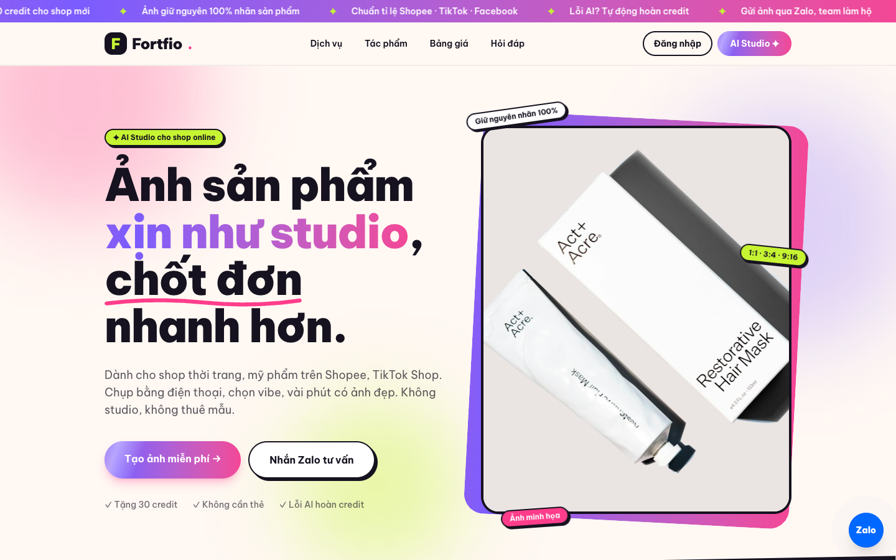
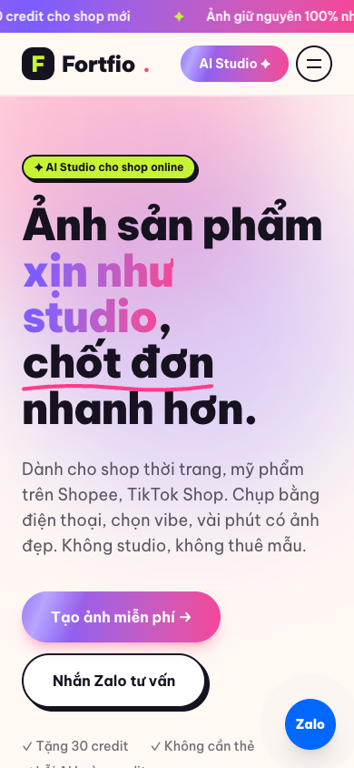
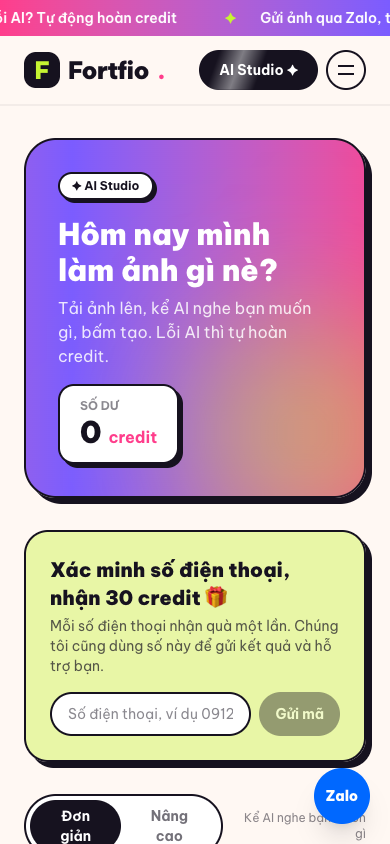
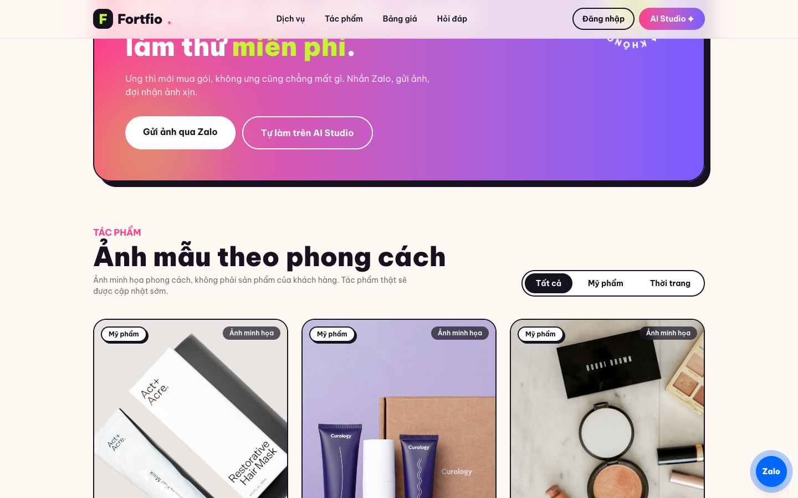

# Đánh giá UI/UX và khả năng chuyển đổi của Fortfio

- **Ngày đánh giá:** 14/10/2026
- **Phạm vi:** trang chủ, đăng ký/đăng nhập, AI Studio (chế độ đơn giản), chạy local tại `localhost:5173`.
- **Cách làm:** đi thử như một khách mới trên desktop (1440px) và mobile (390px), rồi đọc code để kiểm tra những gì ảnh chụp không cho thấy.
- **Khách hàng mục tiêu:** chủ shop thời trang, mỹ phẩm nhỏ trên Shopee và TikTok Shop.

## Điểm tổng quan: 5,5/10

| Trụ cột | Điểm |
|---|---|
| Tư duy sản phẩm | 6/10 |
| Thân thiện, gần gũi | 7,5/10 |
| Bán hàng và chuyển đổi | 3/10 |

**Kết luận chính:** giao diện đẹp, thông điệp rõ và chế độ đơn giản dễ dùng. Nhưng hiện tại một khách mới không thể dùng thử và cũng không thể trả tiền:

- **Không nhận được credit dùng thử:** mã xác minh số điện thoại (OTP) chỉ được ghi vào log server (`LoggingOtpSender`), không có SMS hay Zalo nào gửi đến khách.
- **Không có trang thanh toán:** cả ba nút "Bắt đầu ngay" trong bảng giá chỉ dẫn vào `/studio`.

## Điểm mạnh và điểm yếu

| Điểm mạnh | Điểm yếu |
|---|---|
| Câu chào "Ảnh sản phẩm xịn như studio, chốt đơn nhanh hơn" nói rõ bán gì, cho ai, trong 3 giây | Mã OTP không đến tay khách, nên khách không nhận được 30 credit |
| Giọng văn gần gũi, đúng chất dân bán hàng online ("chốt đơn mỏi tay", "làm ảnh gì nè?") | Không có thanh toán, nút trong bảng giá không dẫn đến đâu |
| Phong cách thiết kế nhất quán, có cá tính và nhận diện tốt | Phần tác phẩm toàn ảnh mẫu của thương hiệu nước ngoài, không có ảnh nào do Fortfio tạo |
| Chế độ đơn giản trong Studio có 5 bước đánh số, ít lựa chọn, có nút AI viết hộ | Không có đánh giá thật, không có trang chính sách, không có thông tin doanh nghiệp |
| "Lỗi AI tự hoàn credit" và "Không cần thẻ" giúp khách bớt lo | Phải đăng ký mới được thấy sản phẩm hoạt động |
| Đã tôn trọng cài đặt giảm chuyển động (`prefers-reduced-motion`) | Trên mobile: trang dài khoảng 14 màn hình, nút bấm nhỏ, nút Zalo che nút chính |

## 1. Tư duy sản phẩm (6/10)

### Thông điệp trong 3 giây đầu: tốt về chữ, yếu về bằng chứng

Tiêu đề, đối tượng và nền tảng đều rõ. Nhưng ảnh lớn bên cạnh là ảnh mẫu của thương hiệu Act+Acre, có dán nhãn "Ảnh minh họa". Nó không chứng minh lời hứa chính là "ảnh chụp điện thoại thành ảnh studio". Code đã có sẵn thanh kéo trước/sau (`BeforeAfter`) nhưng không dùng được vì chưa có ảnh gốc thật.

### Bố cục thông tin: nhiều phần thừa hoặc đã lỗi thời

- Dải số liệu "100% · 3 · 5+ · 30" chỉ để trang trí. "3 tỉ lệ chuẩn sàn" không phải lợi ích mà khách quan tâm.
- Nội dung chưa cập nhật theo sản phẩm hiện tại:
  - Trang vẫn ghi "Video ngắn 5 giây", trong khi sản phẩm đã làm được video 4–30 giây, có nhạc và kịch bản do AI viết.
  - Bước 2 vẫn ghi "Chọn vibe", trong khi chế độ đơn giản giờ là "kể AI nghe". Điểm mạnh nhất hiện tại lại không được nói đến.
- Có ba ưu đãi dùng thử chồng chéo nhau: tặng 30 credit, team làm thử 5 ảnh miễn phí, và gói "Dùng thử 99K". Khách sẽ không biết nên chọn cái nào.

### Hành trình khách hàng bị đứt ở hai chỗ

- **Từ nút "Tạo ảnh miễn phí":** khách phải điền form đăng ký 3 ô, rồi vào Studio với 0 credit. Khách nhập số điện thoại nhưng không bao giờ nhận được mã. Khi bấm Tạo, chỉ thấy lỗi "Không đủ credit: cần 2, còn 0", không có nút nào để đi tiếp.
- **Từ bảng giá:** nút "Bắt đầu ngay" dẫn vào Studio, nhưng không có chỗ nào để trả tiền.

### Giải quyết điểm đau: đúng hướng

Trang đã nói đến chi phí thuê studio, thuê mẫu, chuẩn tỉ lệ sàn và giữ đúng nhãn. Còn thiếu hai nỗi lo lớn của shop nhỏ:

- Shop có nhiều mã sản phẩm, cần làm hàng loạt nhanh.
- Lo AI làm sai sản phẩm. Hiện chỉ có câu "hoàn credit", chưa có ảnh nào chứng minh nhãn được giữ đúng.

## 2. Thân thiện và gần gũi (7,5/10)

### Giọng văn

Hợp với chủ shop trẻ. Có vài từ chuyên môn chưa giải thích: "credit", "vibe", "concept". Khách không biết 1 credit đáng bao nhiêu tiền. Nên ghi kèm giá theo ảnh: gói 299K có 180 credit, mỗi ảnh 2 credit, tức khoảng 3.300đ một ảnh.

### Thẩm mỹ: đẹp, nhưng hơi nhiều chuyển động

Trang dùng gradient hồng tím, viền đen dày và sticker. Cùng lúc có dải chữ chạy, khối màu trôi, sticker bay, huy hiệu xoay và nút Zalo nhấp nháy. Trên máy Android giá rẻ, điều này gây rối mắt và làm trang chậm.

### Dễ dùng trên mobile

- Trang chủ dài khoảng 11.700px, tức khoảng 14 màn hình. Ảnh minh họa của phần đầu trang rơi xuống dưới màn hình đầu tiên.
- Nhiều chỗ bấm nhỏ hơn mức khuyến nghị 44px: link "Thử ngay" cao 24px, link ở chân trang cao 20px.
- Nút Zalo nổi che nút "Tạo tài khoản" trên form đăng ký và che chữ trong Studio.
- Trong Studio, màn hình đầu tiên chỉ có khung chào và thẻ xác minh số điện thoại. Ô tải ảnh nằm khuất bên dưới, và nút chuyển chế độ "Đơn giản" bị xuống 2 dòng.

| Trang chủ trên mobile | Studio trên mobile |
|---|---|
|  |  |

## 3. Bán hàng và chuyển đổi (3/10)

### Nút kêu gọi hành động (CTA)

Nút chính ở đầu trang nổi bật và đặt đúng chỗ. Nhưng có khoảng 8 nút cạnh tranh nhau, thuộc hai hướng song song: tự làm trên Studio, hoặc gửi Zalo để team làm hộ. Trang không giúp khách chọn hướng nào hợp với mình.

### Yếu tố tạo niềm tin: gần như chưa có

- Phần tác phẩm toàn ảnh của Curology, Bobbi Brown, Origins, Estée Lauder. Dù có ghi "minh họa", điều này làm giảm niềm tin và có rủi ro về bản quyền thương hiệu.
- Không có đánh giá, logo hay con số khách hàng thật.
- Không có trang điều khoản, chính sách bảo mật hay chính sách hoàn tiền. Điều này đáng lo vì khách tải ảnh sản phẩm và số điện thoại lên.
- Không có tên doanh nghiệp, mã số thuế; email liên hệ là gmail cá nhân.
- Câu "Giữ nguyên nhãn 100%" là cam kết rất mạnh. Ảnh giữ nguyên nhãn thì đúng, nhưng video có lúc vẫn làm méo chữ trên nhãn.

### Rào cản khi đăng ký và thanh toán: rất cao

- Phải đăng ký trước khi thấy bất kỳ kết quả nào.
- Form đăng ký có 3 ô, không có đăng nhập bằng Google hay Zalo, không có "Quên mật khẩu".
- Không có cách nào trả tiền: không VietQR, không MoMo, không VNPay.

## 5 việc nên làm ngay để tăng doanh thu

1. **Mở đường thu tiền (ưu tiên số 1, chặn toàn bộ doanh thu).**
   - Gửi OTP thật qua Zalo ZNS hoặc SMS. Trong lúc chờ, có thể tặng sẵn khoảng 10 credit khi đăng ký và để phần còn lại cho bước xác minh số điện thoại.
   - Làm luồng nạp tiền bằng VietQR, xác nhận tự động qua Casso hoặc SePay.
   - Cho nút "Bắt đầu ngay" mở trang thanh toán của đúng gói đó.
   - Khi báo lỗi thiếu credit, hiện luôn hai nút "Xác minh SĐT nhận 30 credit" và "Nạp credit".
2. **Cho thử trước, đăng ký sau.**
   - Khách tải ảnh lên ngay trên trang chủ và nhận một ảnh xem trước có watermark. Đến khi muốn tải ảnh gốc mới yêu cầu đăng nhập.
   - Thêm đăng nhập bằng Google hoặc Zalo một chạm.
   - Đây là cách các công cụ AI cạnh tranh đang làm để tăng tỉ lệ khách dùng thật.
3. **Thay ảnh mẫu bằng bằng chứng thật.**
   - Dùng thanh kéo trước/sau ở đầu trang với ảnh do chính hệ thống tạo, ví dụ ca ấm siêu tốc hay tuýp lotion đã chạy thử.
   - Thêm một video mẫu có kịch bản và nhạc.
   - Bỏ toàn bộ ảnh thương hiệu nước ngoài. Khi có khách thật, thêm 3–5 đánh giá kèm tên shop.
4. **Làm chân trang tạo niềm tin và nói giá bằng tiền đồng.**
   - Thêm trang Điều khoản, Bảo mật (nói rõ ảnh và số điện thoại được dùng thế nào), Hoàn tiền.
   - Ghi tên doanh nghiệp hoặc hộ kinh doanh và dùng email theo tên miền.
   - Ghi "khoảng 3.300đ/ảnh" cạnh số credit.
   - Gộp ba ưu đãi dùng thử thành một, và đổi tên gói "Dùng thử 99K" thành "Gói nhỏ".
5. **Gọn trang trên mobile và cập nhật nội dung theo tính năng hiện tại.**
   - Bỏ dải số liệu và rút ngắn trang chủ.
   - Thêm thanh CTA dính ở cuối màn hình trên mobile.
   - Dời nút Zalo để không che nút chính, và tăng vùng bấm lên ít nhất 44px.
   - Trong Studio, thu gọn khung chào để ô tải ảnh nằm ngay màn hình đầu.
   - Viết lại nội dung theo tính năng mới: "Kể AI nghe, AI viết kịch bản", "Video tới 30 giây có nhạc", "Người mẫu cầm sản phẩm".
